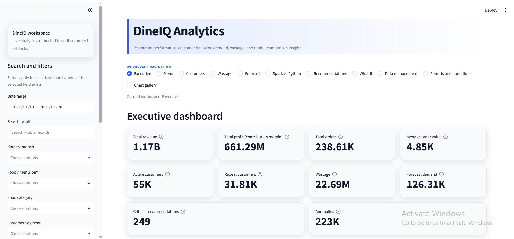
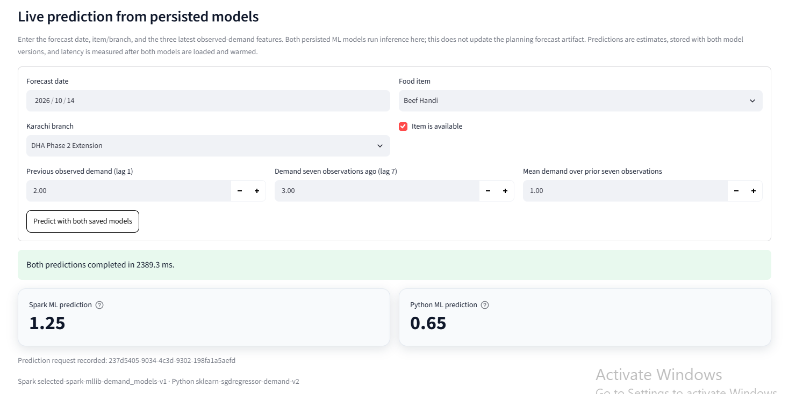
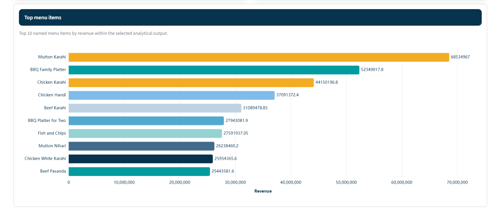
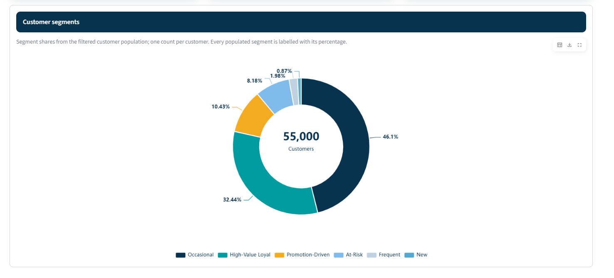
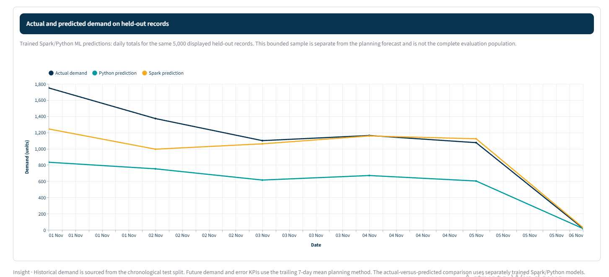
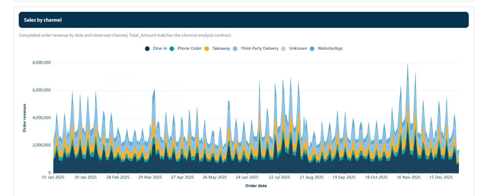
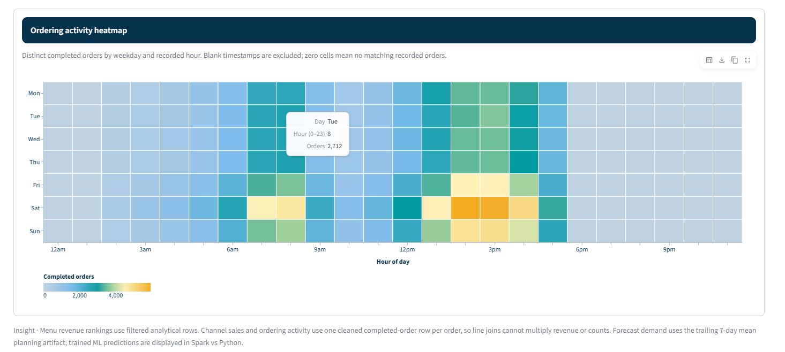
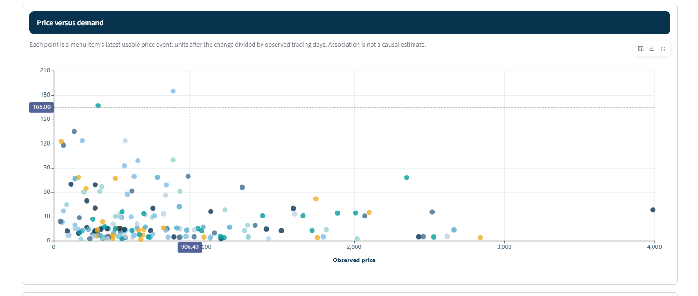

<div align="center">

# 🍽️ DineIQ Analytics — AI-Powered Restaurant Intelligence

An evidence-backed Big Data, Data Science, and AI/ML platform for restaurant
sales, menu, customer, inventory, wastage, forecasting, and operational
decision support.


<p>
  <b>Validated data pipeline · Spark analytics · Independent Python ML ·
  Role-based dashboards · Reports · API · Decision support</b>
</p>

</div>

---

## 📌 Project Overview

**DineIQ Analytics** is an end-to-end restaurant intelligence platform for a
fictional Karachi restaurant chain. It converts validated transaction and
operational data into analytical Parquet tables, SQLite operational records,
machine-learning predictions, reports, recommendations, and interactive
Streamlit dashboards.

The platform helps restaurant teams understand revenue, demand, menu
performance, customer behavior, inventory, wastage, pricing, promotions,
branches, anomalies, and operational opportunities from one controlled
workflow.

## 🔗 GitHub Repository

Clone the complete project from:

[https://github.com/CodeByMan/Dine_IQ_Analytics](https://github.com/CodeByMan/Dine_IQ_Analytics)

## 🎯 Objectives

- Validate source data, schemas, row volumes, keys, and relationships.
- Preserve raw data and document data-quality decisions.
- Build cleaned tables, chronological splits, joins, features, and Parquet
  outputs with Apache Spark.
- Provide sales, revenue, profitability, menu, customer, inventory, wastage,
  pricing, promotion, rating, and branch-level analytics.
- Train and compare independent Spark and Python demand-model pipelines.
- Predict wastage risk using a dedicated classification model.
- Provide role-aware dashboards, reports, CSV exports, recommendations, and
  what-if scenario analysis.
- Persist operational data, model versions, predictions, audit events, and
  evaluation evidence in SQLite.

## ✨ Main Features

### 📊 Business Analytics

- Executive summary with revenue, orders, customers, margin, and wastage KPIs.
- Menu performance, profit drivers, volume drivers, low performers, ratings,
  margins, price sensitivity, and item demand analysis.
- Customer segmentation, RFM analysis, recency distribution, frequency,
  monetary value, repeat behavior, and churn-risk indicators.
- Wastage quantity, wastage cost, wastage reasons, high-risk items, and branch
  comparisons.
- Promotion effectiveness, sales channels, ratings, anomalies, and
  operational recommendations.

### 🤖 Machine Learning and Forecasting

- Spark MLlib demand models: Linear Regression, Decision Tree Regressor, and
  Random Forest Regressor.
- Selected Spark demand model: **LinearRegression**.
- Independent Python demand model: **SGDRegressor**.
- Wastage-risk model: **RandomForestClassifier**.
- Chronological train, validation, and test evaluation.
- Spark/Python comparison on common unseen records.
- Planning forecast based on trailing demand history and lag features.
- What-if simulation for price, demand, revenue, cost, and contribution margin.

### 🔐 Security and Reliability

- Role-based access for administrator, regional manager, manager, and analyst.
- Password authentication and role-aware dashboard visibility.
- SQLite audit records for operational actions and report exports.
- Input validation, safe error messages, bounded model/API operations, and no
  execution of generated code.
- Raw data is kept separate from generated analytical artifacts.

---

## 🔄 End-to-End Workflow

```text
Raw CSV tables
      │
      ▼
Schema, quality, relationship, and integrity validation
      │
      ▼
Cleaned tables, chronological splits, and feature engineering
      │
      ├──► Parquet data foundation
      │       ├── Spark SQL joins and analytics
      │       ├── Descriptive analytics
      │       ├── Demand planning
      │       ├── Wastage-risk model
      │       └── Reports and evidence
      │
      └──► SQLite operational store
              ├── Streamlit dashboard
              ├── Role and permission workflows
              ├── Audit records
              └── API services
```

## 📊 Dataset Scope

| Dataset element | Verified value |
| --- | ---: |
| Karachi locations/branches | 22 |
| Menu items | 185 |
| Customers | 55,000 |
| Orders | 256,880 |
| Order items | 1,105,311 |
| Ratings | 102,604 |
| Inventory records | 48,840 |
| Wastage records | 54,986 |
| Source CSV tables | 12 |

Raw tables include customers, orders, order items, menu items, menu
categories, restaurants/locations, inventory, wastage, ratings, pricing
history, promotions, and menu-item availability.

## 🧠 Model Results

The final demand-model evidence is stored in
`reports/demand_models/build_summary.json`.

| Pipeline | Model | MAE | RMSE | R² | MAPE |
| --- | --- | ---: | ---: | ---: | ---: |
| Spark final test | LinearRegression | 1.163 | 2.180 | 0.424 | 66.22% |
| Python final test | SGDRegressor | 1.178 | 2.469 | 0.261 | 63.05% |
| Seasonal-naive baseline | Lag 7 | 1.423 | 2.795 | 0.053 | 98.94% |

The Spark pipeline trained Linear Regression, Decision Tree Regressor, and
Random Forest Regressor. The selected forecast model improved test RMSE over
the seasonal-naive baseline. MAPE is calculated on non-zero actual demand and
can be high when actual demand is small.

## 🖥️ Streamlit Pages

The dashboard contains the following main pages and workflows:

| Page | Purpose |
| --- | --- |
| Executive | Overall revenue, orders, customers, margin, anomalies, channels, and trends |
| Menu | Item profitability, popularity, ratings, price sensitivity, and menu classifications |
| Customer | Segments, RFM values, recency, frequency, monetary value, and churn indicators |
| Wastage | Historical wastage, cost, reasons, high-risk items, and model-risk outputs |
| Forecast | Demand history, lag features, planning forecast, and forecast metrics |
| Spark vs Python | Independent demand-pipeline predictions, agreement, disagreement, and metrics |
| What-if | Simulated price/demand scenarios and estimated financial outcomes |
| Reports | Filtered report tables and CSV export workflows |
| Recommendations | Menu, inventory, customer, promotion, and branch recommendations |
| Chart Gallery | Reusable charts with data/chart view, image/CSV export, and fullscreen controls |
| Management | Role-aware operational administration, users, audit, and system views |

## 🖼️ Screenshots

| Dashboard | Spark versus Python prediction |
| --- | --- |
|  |  |

| Menu chart | Customer chart |
| --- | --- |
|  |  |

| Forecast chart | Sales by channel |
| --- | --- |
|  |  |

| Peak-order heatmap | Sales demand chart |
| --- | --- |
|  |  |

## 📁 Project Structure

```text
DineIQ_Analytics/
├── config/                 # Dataset and runtime configuration
├── data_generator/         # Dataset checks, quality rules, and validation
├── database/               # SQLite schema, importer, authentication, and audit data
├── documentation/          # SRS, architecture, data, and testing evidence
├── models/                 # Saved Spark, Python, and wastage models
├── notebooks/              # Exploratory and analytical notebooks
├── parquet_data/           # Cleaned tables, splits, features, and outputs
├── processed_data/         # Cleaned CSV tables and transaction splits
├── python_pipeline/        # Python model preparation and verification
├── raw_data/               # Source CSV tables
├── reports/                # Build summaries, metrics, validation, and evidence
├── screenshots/            # Selected dashboard and chart screenshots
├── spark_jobs/             # Spark processing and model-build entrypoints
├── spark_sql/              # Spark SQL definitions and transformations
├── src/dineiq/             # Application, analytics, API, database, and UI code
├── tests/                  # Unit, integration, data, model, API, and UI tests
├── AI_USAGE.md
├── LICENSE
├── README.md
├── requirements.txt
└── .gitignore
```

## 🧰 Technology Stack

| Technology | Purpose |
| --- | --- |
| Python 3.13 | Application, data, and ML runtime |
| Apache Spark / PySpark | Distributed processing, Spark SQL, joins, features, and MLlib |
| pandas / NumPy | Data preparation and numerical operations |
| PyArrow | Parquet writing, reading, schema checks, and value verification |
| scikit-learn | Independent Python model and wastage classifier |
| SQLite | Operational data, users, permissions, audit, predictions, and metadata |
| Streamlit | Interactive dashboard and workflows |
| pytest / unittest | Automated verification |
| Java 17+ | Apache Spark runtime |

## ⚙️ Installation on WSL Ubuntu

### Prerequisites

- Windows 10 or 11 with WSL Ubuntu 24.04
- Python 3.13+
- Java/OpenJDK 17+
- At least 8 GB RAM recommended for local Spark processing
- Git

### Clone and create the environment

```bash
git clone https://github.com/CodeByMan/Dine_IQ_Analytics.git
cd DineIQ_Analytics

python3 -m venv dineiq_analytics_env
source dineiq_analytics_env/bin/activate

python -m pip install --upgrade pip
python -m pip install -r requirements.txt
export PYTHONPATH="$PWD/src"
python -m pip check
```

Do not commit the virtual environment, passwords, `.env` files, database
backups, caches, or temporary rebuild folders.

## ▶️ Run the Complete Project

### Validate the data

```bash
python -m dineiq.cli doctor
python -m dineiq.cli dataset-check
python -m dineiq.cli validate-data
```

### Build the analytical foundation

```bash
python -m dineiq.cli build-data-foundation
python -m dineiq.cli build-descriptive-analytics
python -m dineiq.cli build-demand-planning
python -m dineiq.cli build-operational-intelligence
python -m dineiq.cli build-demand-models
```

### Initialize and check SQLite

```bash
python -m dineiq.cli init

python - <<'PY'
import sqlite3

with sqlite3.connect("database/dineiq.sqlite3") as con:
    print("INTEGRITY_CHECK:", con.execute("PRAGMA integrity_check").fetchone()[0])
    print("FOREIGN_KEY_VIOLATIONS:", len(con.execute("PRAGMA foreign_key_check").fetchall()))
PY
```

## 🧪 Test the Project

Run the complete automated suite:

```bash
python -m pytest -q
```

Run the standard-library test suite as well:

```bash
python -m unittest discover -s tests -p 'test_*.py' -v
```

The verified local run completed with **110 pytest tests passed**, plus the
additional unittest discovery checks. Warnings from NumPy/Pandas deprecations
or Spark's native Hadoop library are environment warnings and are not failed
tests.

## 🔌 Start the API

Open a separate terminal:

```bash
cd /mnt/c/Users/Work/Desktop/TechWiz/DineIQ_Analytics
source dineiq_analytics_env/bin/activate
export PYTHONPATH="$PWD/src"

python -m dineiq.cli serve-api \
  --host 127.0.0.1 \
  --port 8502
```

Check API health from another terminal:

```bash
curl -fsS http://127.0.0.1:8502/health | python -m json.tool
```

## 📈 Start the Streamlit Dashboard

Open another terminal:

```bash
cd /mnt/c/Users/Work/Desktop/TechWiz/DineIQ_Analytics
source dineiq_analytics_env/bin/activate
export PYTHONPATH="$PWD/src"

python -m streamlit run src/dineiq/ui/app.py \
  --server.address 127.0.0.1 \
  --server.port 8501
```

Open the dashboard manually in a browser:

```text
http://127.0.0.1:8501
```

If WSL prints a `gio` browser-launch warning, it is safe to open the URL
manually in Windows Chrome.

## 👥 Roles and Permissions

| Role | Typical access |
| --- | --- |
| Administrator | System administration, users, permissions, audit, and all data |
| Regional manager | Chain/branch operational analysis and management views |
| Manager | Assigned-location operational and analytical views |
| Analyst | Read-only analytical dashboards, charts, and reports |

## 🔐 Security and Data Integrity

- Never commit real passwords, API keys, `.env` files, or private credentials.
- Raw data is separated from derived data and analytical outputs.
- User roles and permissions are stored and enforced through the operational
  database workflow.
- Report exports are generated through controlled application paths.
- Generated AI or model output is treated as data and is not executed as code.
- SQLite integrity and foreign-key checks are part of the verification process.
- Temporary validation, backup, cache, and runtime folders are excluded by
  `.gitignore`.

## 📜 Evidence Files

Important evidence is stored in `reports/`:

```text
reports/data_foundation/
reports/descriptive_analytics/
reports/demand_planning/
reports/operational_intelligence/
reports/demand_models/
reports/demand_split_validation.json
reports/generation_manifest.json
reports/issue_ledger.csv
reports/parquet_verification.json
reports/raw_data_checksums.json
reports/uptime_evidence.json
reports/validation_report.json
reports/validation_report.md
```

Temporary folders such as `dataset_validation_*`, `execution_*`, and
`retrain_verification_*` are local run outputs and should not be committed.

## 🚀 Future Enhancements

- Connect to live restaurant POS and delivery systems.
- Add scheduled model retraining and model monitoring.
- Add richer confidence intervals and prediction explanations.
- Add centralized cloud storage and distributed deployment.
- Add more historical real-world data for stronger generalization.
- Add shared rate limiting and centralized authentication for multi-instance
  deployment.

## 🧑‍💻 Author

**Muhammad Ali Nawaz**  
Data Science / AI Developer

---

## 📄 License

This project is licensed under the [MIT License](LICENSE).

---

<p align="center">
  <b>⭐ If this project helps you, consider starring the repository!</b>
</p>
