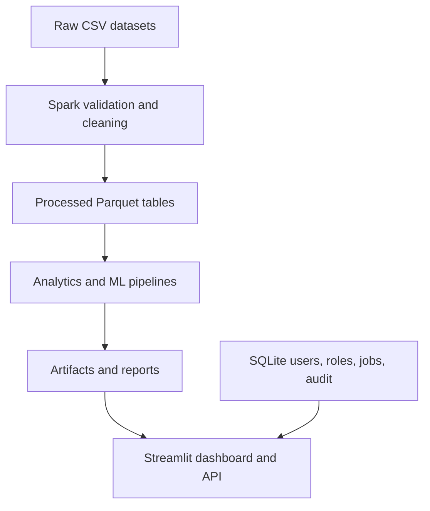
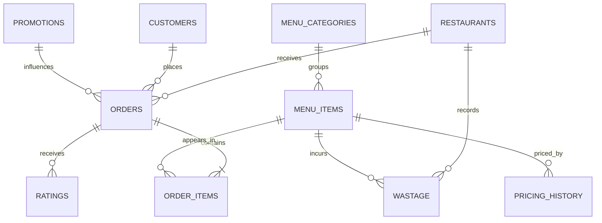
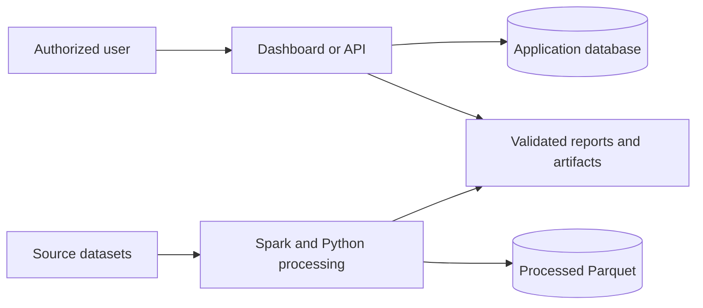
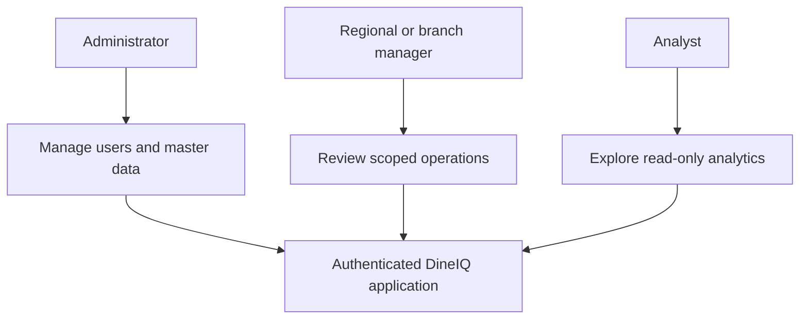
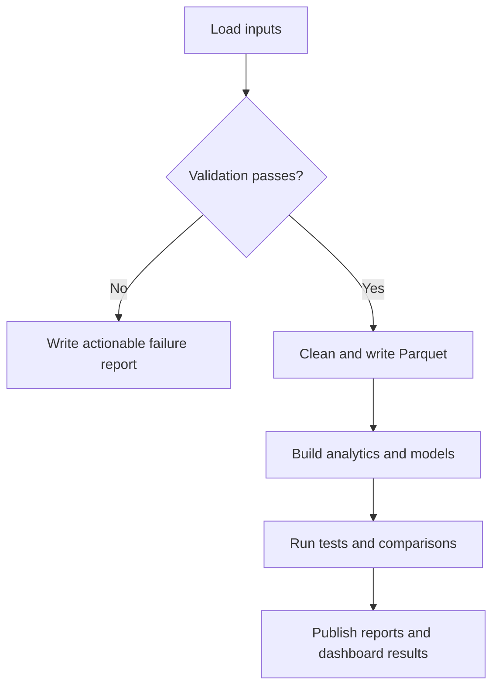
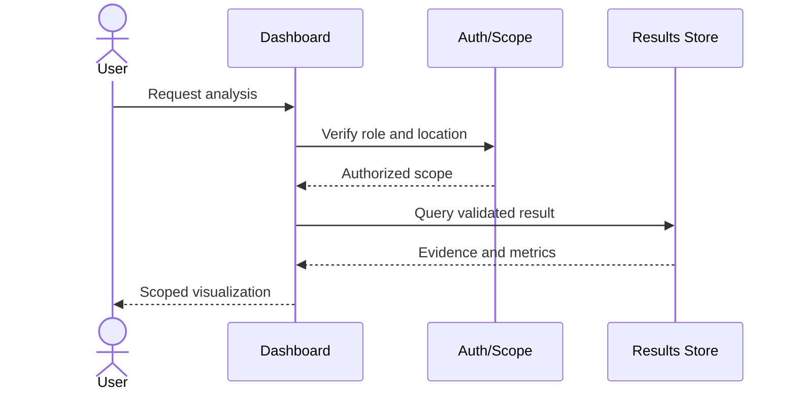

# DineIQ: Big Data Analytics and Decision Support for Restaurant Operations

## 1. Problem definition and background

Multi-branch restaurants generate large, related datasets for customers, menus,
orders, prices, promotions, ratings, inventory, and wastage. Operational teams
need more than static totals: they must identify profitable menu items, understand
customer behavior, forecast demand, control wastage, detect anomalies, and make
location-aware decisions. DineIQ provides one reproducible analytical system for
those tasks while preserving traceability from raw records to dashboard evidence.

The project is necessary because manual spreadsheet analysis does not reliably
enforce relationships, effective-dated prices, chronological model evaluation,
role-based access, or repeatable processing at the required scale.

## 2. Proposed solution, purpose, and scope

DineIQ ingests the SRS dataset, validates and cleans it with Apache Spark, stores
processed tables as Parquet, runs descriptive and predictive analytics, compares
independent Spark MLlib and Python demand models, and presents results through a
role-aware Streamlit dashboard and optional API.

In scope are data quality, Spark SQL, menu and customer analytics, market-basket
analysis, demand forecasting, wastage, price sensitivity, promotion effectiveness,
anomaly detection, operational recommendations, authentication, authorization,
auditing, tests, and generated reports. Payment processing, live point-of-sale
integration, automated purchasing, and claims about unseen evaluator data are out
of scope.

### Assumptions

- Input files follow the documented table contract and use stable identifiers.
- Currency is Pakistani rupees (PKR); business dates use the configured local zone.
- Restaurant, item, and customer identifiers are strings even when numeric-looking.
- The supplied customer identity fields are synthetic and used only for analysis.
- Historical demand is available before forecasts are requested.

### Constraints

- The reference dataset covers Karachi branches and the 2025 calendar year.
- Batch analytics require Java and Apache Spark resources.
- Model quality is bounded by synthetic-data patterns and available history.
- Actual hidden evaluator data cannot be certified before it is received.

## 3. Requirements summary

### Functional requirements

1. Ingest all required CSV tables with explicit schemas.
2. Validate types, ranges, keys, relationships, dates, prices, and promotions.
3. Clean invalid facts with documented, reproducible rules and emit Parquet tables.
4. Execute Spark SQL summaries across menu, customer, location, channel, and time.
5. Produce menu classification, customer segmentation, association rules, demand
   forecasts, wastage risk, pricing, promotion, anomaly, and recommendation outputs.
6. Train and evaluate independent Spark MLlib and Python demand-model pipelines.
7. Present evidence in a role-based dashboard and optional authenticated API.
8. Persist model runs, processing jobs, stored results, and audit events.

### Nonfunctional requirements

- Reproducibility: deterministic configuration and run-specific build summaries.
- Performance: Spark processing and Parquet storage for the full dataset scale.
- Reliability: validation, fail-fast checks, logs, fresh-output guards, and tests.
- Security: password hashing, least privilege, location scope, and audit logging.
- Maintainability: modular pipelines, explicit contracts, and documented execution.
- Privacy: synthetic data, data minimization, and no credentials in source control.

## 4. System and Big Data architecture

Spark supplies distributed ingestion, cleaning, SQL aggregation, feature assembly,
and MLlib training. Parquet provides typed columnar storage. Python analytics add
independent modelling and domain algorithms. SQLite stores application metadata,
authentication, audit, and operational results; it is not the analytical fact store.

### Module descriptions

| Module | Responsibility |
|---|---|
| Data foundation | Schema enforcement, quality checks, cleaning, Parquet output |
| Descriptive analytics | Menu performance and customer segmentation |
| Demand planning | Basket rules, forecasts, wastage, price and promotion analysis |
| Operational intelligence | Anomalies, churn, recommendations, location/menu evidence |
| Demand models | Independent Spark MLlib and Python training/evaluation |
| Dashboard/API | Authorized access to analytics and management workflows |
| Operations | Jobs, health, logs, availability evidence, and error reporting |

## 5. Database and data design

The analytical layer uses the twelve source/processed tables documented in
`dataset/data_dictionary.md`; their keys are listed in `dataset/pk_fk_definitions.md`.
The application layer stores users, audit events, model runs, stored results,
processing jobs, and managed copies of locations, categories, menu items, pricing,
customers, orders, order items, promotions, ratings, inventory, and wastage.

### Entity-relationship design

### Data-flow diagram

### Use-case view

### Analytics activity

### Request sequence

## 6. Dataset generation and data quality

The project dataset is synthetic and seed-controlled, representing 22 Karachi
branches, 55,000 customers, 185 menu items in 12 categories, and twelve months of
activity. Generation models customer, time, channel, promotion, price, rating,
inventory, and wastage relationships. The provided raw dataset remains immutable;
processing creates separate outputs rather than regenerating source evidence.

Quality methodology combines schema validation, null/range checks, duplicate-key
detection, FK validation, order-line reconciliation, effective-price checks,
promotion-window validation, date consistency, rating bounds, inventory logic,
and wastage plausibility. Cleaning decisions are explicit, counted, and reported.
Raw and processed row counts are in `dataset/dataset_statistics.md`.

## 7. Spark processing, SQL, and feature engineering

The data foundation reads every table with an explicit Spark schema, normalizes
types, rejects or quarantines invalid analytical facts according to documented
rules, validates relationships, and writes processed Parquet. Spark SQL aggregates
sales by location, channel, weekday, item, category, promotion, and time period.

Demand features include lagged quantities, rolling history, calendar indicators,
location and item/category context, price and promotion variables, and historical
demand statistics. Feature construction uses only information available before the
prediction date. Invalid and non-finite vectors are rejected before training.

## 8. Required analytical methods and results

### Menu and customer analytics

Menu items are classified as Profit Driver, Volume Driver, Hidden Opportunity, or
Low Performer using demand, margin, and rating evidence. The current build contains
31, 44, 11, and 99 items in those classes respectively. RFM-style customer features
produce High-Value Loyal, Frequent, Occasional, New, At-Risk, and Promotion-Driven
segments; all 55,000 customers receive a segment.

### Market basket and forecasting

Order baskets generate support, confidence, and lift rules plus bundle suggestions.
The current build records 33,180 association rules and 925 recommendations. Demand
planning produces item-location, category, and location forecasts with chronological
evaluation; the current 30-day build contains 122,100 item-location daily records,
360 category daily records, and 660 location daily records.

### Wastage, pricing, and promotions

Wastage analysis combines historical preparation, demand, and wastage behavior to
identify risk. The current classifier reports 0.90884 test accuracy, 0.89230 macro
F1, and 0.96175 ROC AUC. Price-sensitivity output covers 370 records; promotion
effectiveness evaluates all 45 promotions with scope and date checks.

### Anomalies and recommendations

Operational intelligence identifies required sales and rating anomaly types,
churn risk, weak menu/location combinations, availability concerns, and prioritized
recommendations. Every recommendation carries supporting evidence and priority.

## 9. Dual demand-model design and evaluation

The Spark pipeline compares Linear Regression, Decision Tree Regressor, and Random
Forest Regressor using MLlib; Linear Regression is selected in the current build.
The independent Python pipeline selects an SGD Regressor. Both use the same
chronological test records but separate implementations and report their outputs
without forcing agreement.

| Pipeline | MAE | RMSE | R² | MAPE |
|---|---:|---:|---:|---:|
| Spark MLlib | 1.1626 | 2.1803 | 0.4236 | 66.215% |
| Python | 1.1780 | 2.4687 | 0.2610 | 63.047% |

The Python baseline RMSE is 2.7951. Across 246,686 comparison records, prediction
agreement is 37.386%; disagreement is retained as evaluation evidence rather than
hidden. Metric interpretation must consider sparse item-location demand and the
limitations of synthetic history.

## 10. Testing strategy

The SRS test suite covers ingestion and schemas, key relationships, Spark SQL,
analytics, forecasts, model independence and parity contracts, dashboard metrics
and workflows, API and management behavior, role-based security, operations,
error reporting, availability monitoring, and report contracts. Unit and contract
tests use controlled fixtures; integration checks validate generated outputs.
Hidden-data expectations and acceptance cases are documented in
`testing/hidden_data_readiness.md`.

## 11. Security and privacy

Accounts use hashed passwords and role-based authorization. Administrator,
regional-manager, manager, and analyst permissions follow least privilege;
location-scoped roles cannot access other branches. Sensitive management actions
and model/process events are auditable. Deployment must protect secrets, restrict
network exposure, use TLS, patch dependencies, back up databases, and avoid logging
credentials or unnecessary identity fields.

The dataset is synthetic. Nevertheless, the system treats customer-like fields as
confidential, minimizes display and export, and separates raw data from published
analytical evidence.

## 12. Limitations and future enhancements

Current limitations include one synthetic city/year, batch rather than streaming
processing, forecast uncertainty on sparse series, SQLite scalability limits for
multi-user production workloads, and no advance proof against unseen evaluator
data. Model metrics show useful but incomplete predictive power, so recommendations
remain decision support rather than automatic operational commands.

Future work may add live POS/inventory connectors, multi-city and multi-year data,
probabilistic forecast intervals, drift monitoring, causal promotion experiments,
managed distributed storage, a production relational database, scheduled retraining,
notification workflows, and formal privacy retention controls.

## 13. Reproducibility and evidence

Follow `INSTALLATION.md` and `EXECUTION.md`. The canonical evidence is the generated
content under `reports/`, especially `validation_report.json` and the module build
summaries. Dataset field definitions, statistics, and key relationships are kept in
the `dataset/` subdirectory. Values in this report describe the validated supplied
build; rerun the pipeline and review regenerated reports after changing inputs.
